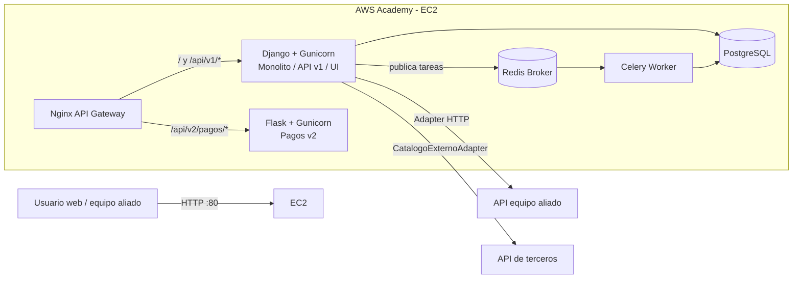

# Arquitectura - Entregable 2

## Vista de contenedores y despliegue

## Decisiones

- Nginx es el único puerto público y conserva URLs estables.
- Django mantiene la UI, autenticación, catálogo y órdenes.
- Flask aísla el procesamiento v2 de pagos mediante Strangler Pattern.
- Redis desacopla la petición HTTP de las notificaciones ejecutadas por Celery.
- Las integraciones dependen de adaptadores propios y de variables de entorno.
- gettext y `LocaleMiddleware` permiten alternar español e inglés.

## Contratos principales

| Método | Ruta | Responsable |
|---|---|---|
| GET | `/api/v1/integracion/catalogo/` | Servicio JSON provisto por Django |
| GET | `/api/v1/integracion/aliado/` | Consumo del equipo aliado |
| GET | `/api/v1/integracion/recomendaciones/` | API externa mediante Adapter |
| POST | `/api/v1/ordenes/` | Creación de orden Django |
| POST | `/api/v2/pagos/procesar` | Microservicio Flask |

La URL real del aliado se configura en `ALLY_SERVICE_URL`; no queda quemada en el código.
