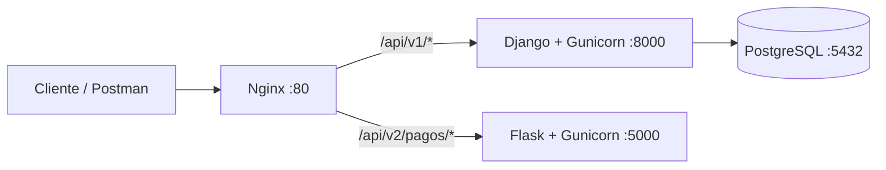

# Migración a Microservicios (Strangler Pattern)

## Módulo estrangulado: procesamiento de pagos

El marketplace conserva el monolito Django para catálogo, órdenes, usuarios e
inventario, pero introduce una versión independiente del procesamiento de pagos
en Flask. Nginx es el único punto de entrada y decide el backend según la versión
de la URL.

## Matriz de decisión

| Módulo | Frecuencia de cambio | Consumo de recursos / riesgo de bloqueo | Acoplamiento actual | Decisión |
|---|---|---|---|---|
| Catálogo e inventario | Baja | Bajo | Alto: productos, variantes, vendedores y órdenes | Mantener en Django |
| Creación de órdenes | Media | Medio | Muy alto: cliente, stock, cupones y subórdenes | Mantener en Django |
| Procesamiento de pagos | Alta | Alto: integra proveedores externos y puede esperar respuestas de red | Medio: requiere orden, monto y método | **Estrangular hacia Flask** |
| Notificaciones | Media | Medio: correo u otros canales externos | Bajo | Candidato futuro |

### Justificación

Pagos es el mejor límite inicial porque los proveedores, reglas y métodos cambian
con mayor frecuencia que el catálogo. Una espera o falla del proveedor puede
consumir trabajadores del monolito y afectar funciones no relacionadas. El
contrato mínimo (`orden_id`, `monto`, `metodo`) permite aislar la lógica detrás de
JSON sin trasladar el modelo completo de órdenes.

No se eligió la creación de órdenes porque actualmente coordina transacciones de
stock, cupones, vendedores, subórdenes y detalles. Extraerla primero implicaría un
alto riesgo de inconsistencias distribuidas. El catálogo tampoco presenta una
carga o frecuencia de cambio que justifique el costo operativo de otro servicio.

## Separación técnica

- **Django v1:** mantiene `POST /api/v1/ordenes/<id>/pagar/` y las demás funciones
  heredadas.
- **Flask v2:** recibe `POST /api/v2/pagos/procesar` y devuelve JSON nativo.
- **Nginx:** dirige `/api/v1/` a `django_web:8000` y `/api/v2/pagos/` a
  `pagos_flask:5000`.
- **Docker Compose:** levanta PostgreSQL, Django, Flask y Nginx en una red interna.
- **Resiliencia:** Flask devuelve errores `400` con campos detallados y un error
  `500` estructurado para fallas inesperadas.

## Arquitectura resultante



## Contrato del microservicio v2

Solicitud:

```http
POST /api/v2/pagos/procesar
Content-Type: application/json
```

```json
{
  "orden_id": 15,
  "monto": 120000,
  "metodo": "PSE"
}
```

Respuesta exitosa:

```json
{
  "servicio": "Microservicio Flask de Pagos (v2)",
  "orden_id": 15,
  "monto": 120000.0,
  "metodo": "PSE",
  "estado": "PROCESADO",
  "referencia": "PAY-..."
}
```

## Impacto esperado

- Los cambios de proveedores de pago pueden desplegarse sin reconstruir Django.
- Las fallas del servicio v2 quedan separadas del catálogo y la creación de órdenes.
- Nginx conserva una URL estable para los clientes durante la migración gradual.
- El siguiente paso técnico sería persistir el resultado mediante un contrato
  idempotente y sincronizar el estado de la orden, evitando pagos duplicados.

## Ejecución y verificación

```bash
cp .env.example .env
docker compose up -d --build
docker compose ps
```

```bash
curl -X POST http://localhost/api/v2/pagos/procesar \
  -H "Content-Type: application/json" \
  -d '{"orden_id":15,"monto":120000,"metodo":"PSE"}'
```

Los logs de Nginx incluyen el upstream y permiten comprobar que v1 llega al
puerto `8000` y pagos v2 al puerto `5000`:

```bash
docker compose logs nginx
```
